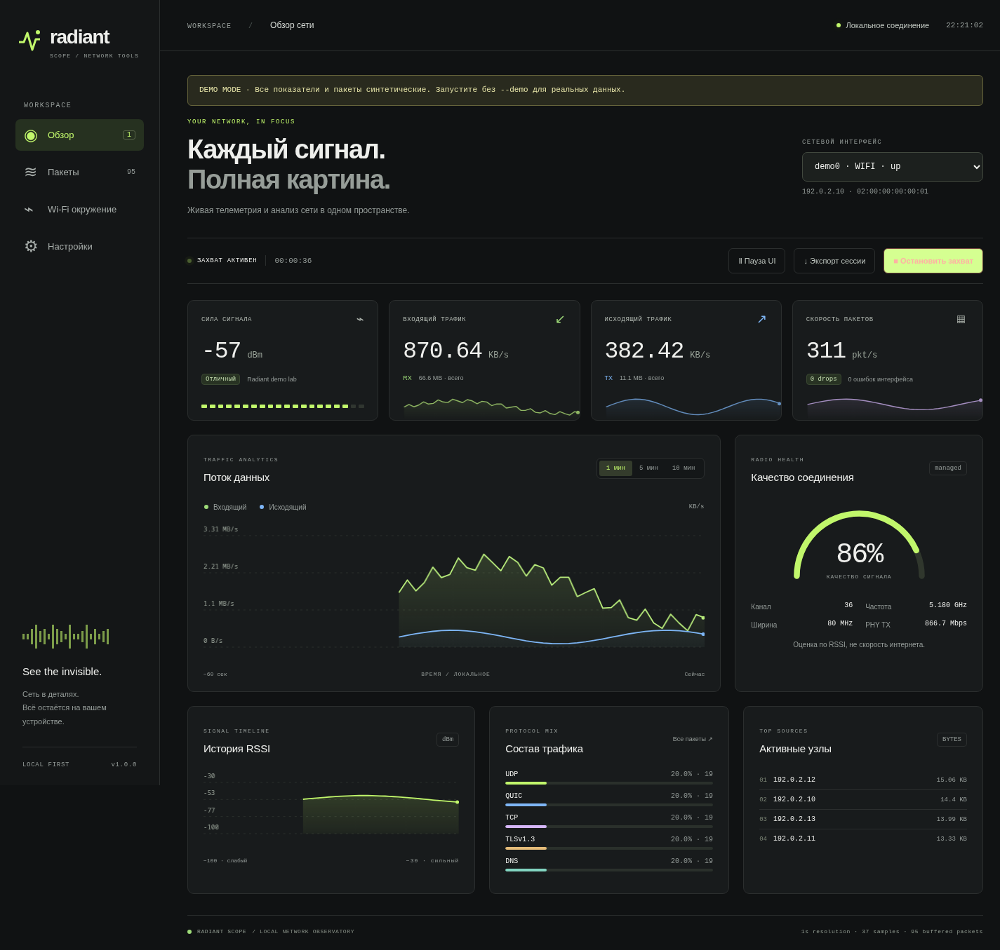

<div align="center">

# Radiant Scope

**See the invisible.**

Локальная обсерватория вашей сети: RSSI, трафик, пакеты и Wi-Fi-окружение.

[](https://github.com/ValentinStars/radiant-scope/actions/workflows/ci.yml)
[](https://github.com/ValentinStars/radiant-scope/releases/latest)
[](LICENSE)


[Скачать](https://github.com/ValentinStars/radiant-scope/releases/latest) · [Возможности](#возможности) · [Установка](#установка) · [Архитектура](#архитектура)

</div>



## Возможности

- **Живой RSSI:** dBm, история, оценка качества, SSID, канал, частота, ширина и PHY TX bitrate.
- **Трафик:** RX/TX в B/s, KB/s или MB/s, packet rate, счётчики drops и ошибок.
- **Инспектор пакетов:** TShark, BPF-фильтры, поиск по IP/протоколу/информации, фильтр протокола, детали выбранного пакета.
- **Аналитика:** состав протоколов, активные источники по объёму, графики за 1/5/10 минут.
- **Wi-Fi-окружение:** кэш NetworkManager, SSID/BSSID, относительный сигнал, безопасность, каналы и частоты.
- **Monitor mode:** опциональный `tshark -I` для поддерживаемого адаптера; RSSI отдельных пакетов при наличии radiotap.
- **Экспорт:** JSON сессии и CSV буфера пакетов; хранение только в оперативной памяти.
- **Интерфейс:** адаптивная тёмная панель, анимации, reduced motion, пауза отображения, сохранение настроек браузера.
- **Без облака:** сервер только на `127.0.0.1`, без CDN и внешних запросов приложения.
- **Ноль зависимостей Python** во время работы. Нужен Python 3.10+ и Linux.

## Быстрый запуск

```sh
git clone https://github.com/ValentinStars/radiant-scope.git
cd radiant-scope
./start.sh
```

Откройте **http://127.0.0.1:8765**. Активный Wi-Fi-интерфейс выбирается автоматически.

Или скачайте готовый `.pyz` из [Releases](https://github.com/ValentinStars/radiant-scope/releases/latest):

```sh
python3 radiant-scope-1.0.0.pyz
```

Для знакомства без доступа к сети:

```sh
./start.sh --demo --port 8766
# http://127.0.0.1:8766 — явно обозначенные синтетические данные
```

Пакеты в demo появляются после нажатия «Начать захват». Деморежим никогда не подменяет реальные данные автоматически.

## Установка

### Debian / Ubuntu

```sh
sudo apt install python3 iw iproute2 network-manager tshark
sudo dpkg-reconfigure wireshark-common
# Разрешите захват непривилегированным пользователям в диалоге.
sudo usermod -aG wireshark "$USER"
```

### Arch Linux

```sh
sudo pacman -S python iw iproute2 networkmanager wireshark-cli
sudo usermod -aG wireshark "$USER"
```

После изменения групп выйдите из пользовательского сеанса и войдите снова. Проверьте `dumpcap -D`: он должен перечислять интерфейсы. Приложение запускается **обычным пользователем**. Не назначайте capabilities интерпретатору Python.

Установка как CLI в виртуальное окружение:

```sh
python3 -m venv .venv
.venv/bin/pip install .
.venv/bin/radiant-scope --port 8765
```

## Как пользоваться

1. Выберите интерфейс в верхней части экрана. Смена интерфейса останавливает захват и очищает историю/буфер.
2. Обзор сразу показывает системные счётчики; для Wi-Fi доступны RSSI и параметры ассоциации.
3. В **Настройках** задайте BPF при необходимости: `tcp`, `port 53`, `host 192.0.2.10`, `tcp port 443 or udp port 443`.
4. Нажмите **Начать захват**. Новый захват очищает предыдущий буфер. Ошибки TShark отображаются над панелью.
5. В **Пакетах** найдите нужный адрес/протокол. Клик или Enter открывают детали.
6. **Wi-Fi окружение → Обновить окружение** читает кэш NetworkManager без принудительного сканирования.
7. Остановите захват перед экспортом, если нужна стабильная выборка. Пауза UI замораживает только отображение.

### Monitor mode

Используйте запасной Wi-Fi-адаптер: переход радио в monitor mode может разорвать соединение. Выберите его в приложении и включите **802.11 monitor mode** в настройках перед захватом. Приложение передаёт `-I` TShark, без скрытой перенастройки адаптеров или каналов.

Поддержка зависит от драйвера, аппаратуры и libpcap. Если адаптер уже подготовлен как monitor-интерфейс, выберите его напрямую. Сырые 802.11-пакеты и их RSSI доступны только если драйвер отдаёт radiotap. Обычный managed-интерфейс показывает трафик хоста и RSSI текущей ассоциации, а не весь эфир.

## Что именно измеряется

| Показатель | Источник и смысл |
| --- | --- |
| RX / TX | Разность байтов Linux `/sys/class/net/*/statistics` за фактический интервал, байты/с |
| pkt/s | Разность RX + TX packets того же интерфейса |
| RX/TX total, drops, errors | Системные накопительные счётчики за срок работы интерфейса; не потери конкретного захвата |
| RSSI | `iw dev <interface> link` / `station dump`, обновление примерно раз в 3 секунды |
| Качество % | Условная оценка `clamp(2 × (RSSI + 100), 0, 100)`, не скорость интернета |
| PHY TX | Согласованная радиоскорость от `iw`, не пользовательская пропускная способность |
| Протоколы / узлы | Агрегаты текущего захвата; узлы ранжируются по байтам источника |
| Wi-Fi signal % | Относительное значение NetworkManager, не перевод в dBm |
| Каналы | Число видимых кэшированных AP, не спектроанализ и не измерение загрузки эфира |

Если адаптер, инструмент или измерение недоступны, показывается `—`, пустое состояние или ошибка. Трафик интерфейса и отфильтрованный захват могут иметь разные объёмы.

## Ограничения и приватность

- Linux only; Ethernet и loopback поддерживают трафик/пакеты, без Wi-Fi-метрик.
- История: **600** измерений с шагом примерно 1 с. Пакетный буфер: **2000** записей.
- UI и JSON содержат последние **500** пакетов. CSV выгружает весь текущий буфер до 2000.
- Захват автоматически заканчивается через **1 час**, snapshot length — **256 B**, capture buffer — **8 MiB**.
- Сводки основаны на ограниченном snaplen. Полного hex/payload-декодера и экспорта PCAP в v1 нет.
- IP-источники агрегируются до 2048 уникальных адресов. При превышении новые источники не добавляются в рейтинг, уже учтённые продолжают обновляться.
- Не публикуйте экспорты без проверки: они содержат адреса и сетевые метаданные.
- Loopback-сервер предназначен для одного доверенного локального пользователя. Не выставляйте порт в интернет.

## Архитектура

Python standard library (`ThreadingHTTPServer`, subprocess, bounded deques) + обычные HTML/CSS/JavaScript и Canvas. Нет npm-сборки, внешних шрифтов и runtime-пакетов Python.

```text
Browser · 127.0.0.1
  ├─ REST telemetry / controls / export
  └─ Python local server
       ├─ sysfs → byte / packet counters
       ├─ iw → RSSI / radio details
       ├─ nmcli → cached access points
       └─ tshark → bounded packet summaries
```

Изменяющие запросы требуют токен текущего процесса; сервер проверяет Host, использует CSP и не запускает shell-команды из параметров пользователя. Подробнее: [SECURITY.md](SECURITY.md).

Интеграция опирается на [официальное руководство TShark](https://www.wireshark.org/docs/man-pages/tshark.html) и [документацию Linux Wireless / iw](https://wireless.docs.kernel.org/en/latest/en/users/documentation/iw.html).

## Разработка и релизы

```sh
python3 -m unittest discover -s tests -v
node --check radiant_scope/web/app.js
python3 scripts/build_release.py
python3 dist/radiant-scope-1.0.0.pyz --help
```

GitHub Actions запускает тесты на Python 3.10 / 3.12 / 3.14 и собирает wheel + sdist. Релиз v1.0.0 включает самостоятельный zipapp и SHA256SUMS. Архив исходников доступен у GitHub автоматически.

[Changelog](CHANGELOG.md) · [Contributing](CONTRIBUTING.md) · [MIT License](LICENSE)
